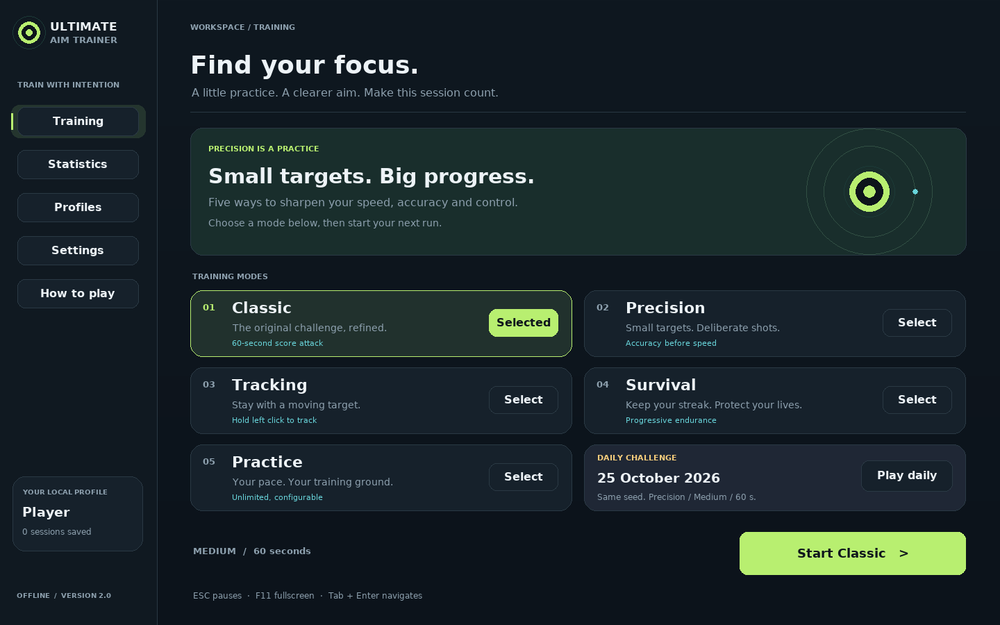
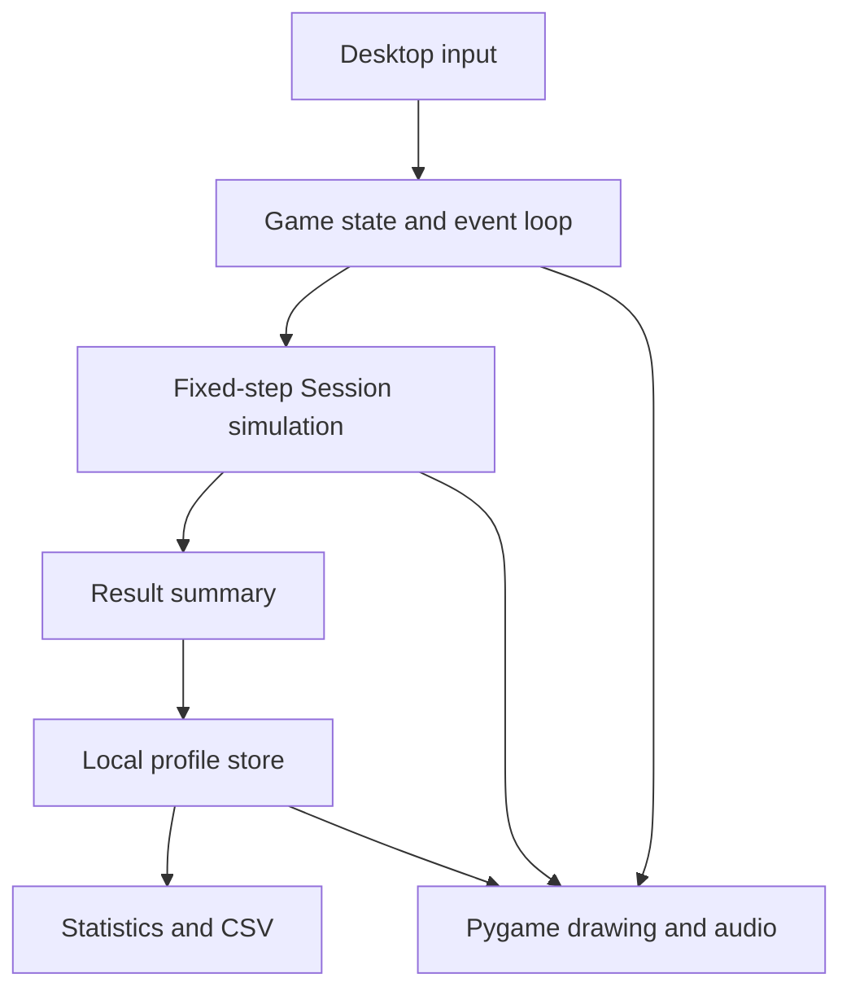

<div align="center">

# Ultimate Aim Trainer 2.0

**Find your focus. Build your precision. See your progress.**

A complete offline Python/Pygame desktop game with five training modes, a redesigned interface, local profiles, daily challenges, achievements and persistent statistics.

**Python 3.11+ · Pygame Community Edition · Local JSON storage · No account or GPU required**

[Start playing](#quick-start) · [Game modes](#five-training-modes) · [Version comparison](#version-10-vs-20) · [Architecture](#architecture) · [Testing](#testing-and-verification)

</div>



More screens: [Tracking](docs/screenshots/tracking.png) · [Settings](docs/screenshots/settings.png) · [Statistics](docs/screenshots/statistics.png) · [Results](docs/screenshots/results.png). Screens show local test sessions; their save data is not bundled.

## What is this project?

Ultimate Aim Trainer is a mouse-control training game. You click targets, follow moving targets and review how accurately and quickly you performed. Version 2.0 develops the original coursework project into a structured desktop application while preserving the original source and submission reports for reference.

It is useful for practicing mouse precision, demonstrating Python game development, learning event-driven programming and presenting a project with measurable behavior and readable source code. It is a standalone training game: it does not connect to another game, change mouse-driver settings or control other applications.

The core programming language is **Python**. Pygame handles the window, input, drawing and sound. All gameplay rules are local and deterministic when supplied with the same seed and input timing. There is no AI model, paid API, internet dependency during play or claim that playing guarantees improvement in another game.

## Version 1.0 vs 2.0

| Area | Original v1.0 | Delivered v2.0 |
|---|---|---|
| Gameplay | One growing/shrinking target challenge | Classic, Precision, Tracking, Survival and Practice |
| Interface | Basic gradient menu, options and HUD | Training dashboard, mode cards, HUD, pause overlay, results, settings, profiles and statistics |
| Timing | Wall-clock session timing; pause consumes session time | Active fixed-step simulation; pause freezes targets, combos and session time |
| Input | All mouse buttons count; current cursor position used for clicks | Left-button firing only; click-event position mapped through window scaling |
| Lives | Missed clicks lose lives; expired targets disappear without penalty | Missed arena shots and expired targets cost a life in applicable modes |
| Combos | Multiplier can remain high after the combo interval | Explicit gap/miss/expiry reset and x8 multiplier cap |
| Navigation | Options return values can be overwritten | Explicit screen states and one event loop |
| Results | Quit button only, despite restart handling in code | Restart, choose a mode, statistics, persistence and achievement feedback |
| Display | Fixed 1280 × 720 window | Resizable, aspect-preserving 1440 × 900 logical canvas and F11 fullscreen |
| Sound | Mixer initialization required; no generated sound bank | Generated click/hit/miss/finish tones, volume control and safe silent fallback |
| Progress | Session results only | Up to 20 local profiles, 1,000 retained sessions per profile, bests and accuracy trends |
| Personalization | Difficulty selection | Crosshair style/size/color, practice settings, durations, frame cap, audio and motion preferences |
| Challenges | No daily challenge or achievements | Repeatable date-seeded Precision challenge and seven local achievements |
| Data | No saved history | Atomic JSON writes, damaged-file recovery and CSV export |
| Verification | No supplied automated suite | Model/storage/UI tests plus a real SDL event-dispatch smoke script |
| Delivery | Source bundled with a virtual environment | Clean source ZIP, installation scripts, tests, documentation and original coursework archive |

**Classic preserves the original 60-second training concept, not its exact old balance or numerical scoring.** Version 2.0 uses the documented points and lifetimes below. Old coursework reports describe v1.0 and are retained unchanged; they should not be presented as v2.0 documentation.

## Quick start

Use Python **3.11 or newer** and a desktop session. The game opens a native window, not a browser.

### Windows / PyCharm

Extract the ZIP and open the folder containing `aim_trainer.py`.

```powershell
py -3 -m venv .venv
.\.venv\Scripts\python.exe -m pip install -r requirements.txt
.\.venv\Scripts\python.exe aim_trainer.py
```

If the `py` launcher is unavailable, use `python -m venv .venv` for the first command. In PyCharm, select `.venv\Scripts\python.exe` as the interpreter and run `aim_trainer.py`.

You can also double-click **start_windows.bat**. It creates the environment and installs the game dependency when needed. The first installation requires internet access; installed gameplay works offline.

### Linux / macOS

```bash
python3 -m venv .venv
.venv/bin/python -m pip install -r requirements.txt
.venv/bin/python aim_trainer.py
```

Alternatively, run `sh start_unix.sh`. No images, fonts or sound files need to be downloaded separately: the game draws its visuals, uses available system fonts and generates its tones.

### Optional installed command

```bash
python -m pip install -e .
aimtrainer
```

`python -m aimtrainer` also works from the project directory. Both commands launch the same application.

Pygame Community Edition is installed as `pygame-ce` and imported as `pygame`. Use a fresh virtual environment; do not install the separate `pygame` distribution alongside it in the same environment.

## Five training modes

| Mode | Objective | Length | Lives / settings |
|---|---|---|---|
| **Classic** | Click targets and build quick-hit combos | 60 seconds | 10 lives; Easy / Medium / Hard |
| **Precision** | Hit smaller targets accurately | 30 / 60 / 90 / 120 seconds | 10 lives; higher base points per hit |
| **Tracking** | Hold left click while following a moving target | 30 / 60 / 90 / 120 seconds | No life penalty; points reward time on target |
| **Survival** | Last as long as possible | Until lives run out | Spawn rate increases and target lifetime decreases |
| **Practice** | Train without pressure | Until you end the session | No life penalty; custom target radius and spawn interval |

Every run starts with a three-second countdown. A timed run can finish early if its lives run out. The simulation pauses automatically when the window loses focus. If focus is lost during the countdown, press Enter to restart the countdown.

### Daily challenge

The daily card launches **Precision / Medium / 60 seconds** with a seed derived from the computer's local calendar date. Gameplay settings are fixed for that daily run; your personal crosshair/audio/motion preferences remain available. The challenge date and seed are saved with the result.

People using the same date and game version see the same seeded spawn sequence at equivalent simulation times, subject to the same target-placement state. It is an offline challenge with no server clock, anti-cheat, online ranking or global leaderboard.

## Controls

| Input | Action |
|---|---|
| Left click in the arena | Shoot a target in click-based modes |
| Hold left click | Track the moving target in Tracking |
| ESC during play / pause | Pause / resume |
| ESC in settings, statistics, profiles or help | Return to Training |
| ESC during countdown | Cancel back to Training |
| F11 | Toggle fullscreen; return to the previous window size |
| Tab / Shift+Tab | Move keyboard focus through buttons |
| Enter / Space | Activate the focused button |
| R on the results screen | Restart the same mode |
| Click profile-name field, type, Enter | Create a local profile |
| Pause → End session & save | Save and leave Practice, or end another run early |
| Window close / How to play → Quit application | Exit |

Right clicks and clicks outside the arena do not count as shots. Black letterbox margins are excluded from input coordinates. Closing the window or restarting an unfinished run discards that unfinished attempt; only the results flow saves a session.

## Scoring and measurements

### Click-based modes

- Classic, Survival and Practice award **100 base points per hit**.
- Precision awards **150 base points per hit**.
- A new hit continues the combo if it occurs within **650 ms of active simulation time** after the previous hit.
- The multiplier is `min(8, 1 + floor((combo - 1) / 3))`: hits 1–3 use x1, hits 4–6 use x2, continuing up to x8.
- A miss, an expired target or a gap over 650 ms resets the combo and multiplier.
- Classic, Precision and Survival start with **10 lives**. Each missed arena shot or expired target removes one life. Practice keeps its lives unchanged.

Difficulty changes the base radius, spawn interval and lifetime. Easy / Medium / Hard begin with approximately **0.85 / 0.65 / 0.48 seconds between spawns**, **3.2 / 2.5 / 1.9-second lifetimes**, and **38 / 30 / 23-pixel maximum radii** on the logical canvas. Precision uses 62% of the normal radius. Targets grow and shrink during their lifetime; collision checks use their current visible radius. Placements are bounded to the arena and reject overlapping targets.

### Tracking

Tracking points equal `round(100 × on-target seconds)`. Time only counts when the left button is held and the pointer lies inside the moving target. Tracking accuracy is **on-target time / time holding**, rather than hits / shots. The result also shows session coverage: on-target time / active session duration. A brief accurate hold may give a high accuracy percentage but earns few points.

### Results and fair comparisons

Results include score, active time, hit accuracy, hits/shots, missed shots, expired targets, best combo, average spawn-to-hit delay and targets per second. Tracking replaces irrelevant hit metrics with its time-based measurements.

**Average hit time includes visual search and mouse movement; it is not a laboratory reaction-time measurement.** Tracking samples and collisions are evaluated at 120 simulation steps per second. Results do not measure physical mouse input latency or monitor refresh latency.

Personal bests are separated by **mode, difficulty and configured duration**. Daily runs use a separate challenge-date group. Practice, zero-score runs and manually ended competitive runs are excluded from personal-best tables. History keeps these runs so you can still inspect or export them. Personal bests belong to the active local profile, not an online ranking.

## Profiles, statistics and achievements

- Create up to **20 profiles** with names of 1–24 readable characters. Names are case-insensitively unique.
- Each profile has its own settings and up to **1,000 recent saved sessions**.
- Statistics includes a mode filter, paginated history, a last-12-runs accuracy chart, grouped personal bests and achievement cards.
- Accuracy trends can mix click and tracking measurements when the All filter is used. Select one mode for a more meaningful comparison.
- Seven achievements reward a first hit, accuracy over at least 20 shots, a 10-hit combo, 60-second survival, 15 on-target tracking seconds, completing a daily challenge and ten saved sessions.
- Export the active profile's retained history with **Statistics → Export history CSV**. CSV includes UTF-8 BOM and spreadsheet-formula protection.

Profiles are local organization, not password-protected accounts. Anyone who can access the save folder can edit the data. The game intentionally does not implement network accounts or anti-cheat.

## Settings and accessibility options

Settings save automatically for the active profile. Click a value, or focus it and press Enter, to cycle choices.

| Preference | Choices |
|---|---|
| Difficulty | Easy / Medium / Hard |
| Precision / Tracking duration | 30 / 60 / 90 / 120 seconds |
| Practice target radius | 18 / 28 / 40 / 54 logical pixels |
| Practice spawn interval | 0.4 / 0.65 / 0.9 / 1.2 seconds |
| Crosshair | Cross / Dot / Circle / Cross + dot |
| Crosshair size | 8 / 14 / 20 / 26 logical pixels |
| Crosshair color | Mint / White / Coral / Gold |
| Sound volume | 0 / 25 / 50 / 75 / 100% |
| Comfort | Toggle hit particles, miss screen shake and reduced motion |
| Frame cap | 60 / 120 / 144 rendered frames per second |

Reduced motion suppresses gameplay particles, shake and the dashboard orbit animation. Targets still move/grow because that motion defines the training task. System fonts, keyboard menu navigation and high-contrast crosshairs are included; this Pygame application does not claim screen-reader accessibility certification.

## Where your data lives

The game saves outside the source project, so replacing the ZIP does not overwrite progress.

| Platform | Default folder |
|---|---|
| Windows | `%LOCALAPPDATA%\UltimateAimTrainer` |
| Linux | `$XDG_DATA_HOME/ultimate-aim-trainer`, or `~/.local/share/ultimate-aim-trainer` |
| macOS | `~/.local/share/ultimate-aim-trainer` by default; the same XDG override is supported |

The exact path appears in **How to play**. The folder contains `progress.json`, an `exports/` subfolder after CSV export, and recovery JSON files when a damaged save is detected.

To use another folder:

```bash
python aim_trainer.py --data-dir ./my-training-data
```

You can also set `AIMTRAINER_DATA`. The command-line path takes precedence. Back up the whole data folder while the game is closed. The original v1.0 supplied no persistent history to migrate.

Writes use a temporary file, flush/fsync and atomic replacement. Invalid JSON/unknown save formats are preserved as recovery copies and a fresh profile is provided. Unreadable individual records are skipped. If the folder cannot be written, the game reports the problem and retains that visit's progress in memory; it cannot promise persistence across a restart until permissions are fixed.

## Architecture



The application has one event loop and explicit Training, Countdown, Playing, Paused, Results, Statistics, Profiles, Settings and Help states. Pause does not open a nested gameplay loop. Menus never start a game through an overwritten return value.

`model.py` contains pure Python simulation and scoring. It does not import Pygame, making timing and rules testable without a display. `app.py` coordinates input/state transitions, `ui.py` handles cached text and drawing, `audio.py` generates optional tones, and `storage.py` manages validated local data.

A fixed 1/120-second simulation step separates gameplay from the 60/120/144 render cap. The interface renders to a 1440 × 900 canvas and scales with aspect-preserving letterboxing. Mouse event coordinates are transformed through the same viewport, including the active shake offset. Focus loss pauses the run.

## Performance work

- Background gradients are created once rather than rebuilt every frame.
- Repeated text is cached with a bounded 768-entry cache.
- Particles are bounded to 120 and drawn directly, avoiding the original per-particle surface allocation on every update.
- Spawn placement tries at most 40 candidates. Target population remains bounded by lifetimes and spawn intervals.
- Only visible statistics rows are drawn; save history is limited per profile.
- Generated tones are built once. Sound failure falls back to silent play.

The smoke checker reports a measured median and p95 for CPU update/drawing/scaling calls in its documented environment. See [VALIDATION.md](docs/VALIDATION.md). **Those headless measurements are not physical-display FPS, input latency or a benchmark against v1.0.** Actual speed depends on window resolution, CPU, SDL backend, fonts and the desktop compositor.

## Project structure

```text
UltimateAimTrainer-2.0/
├── aim_trainer.py             # Familiar launcher
├── aimtrainer/
│   ├── __init__.py            # Version
│   ├── __main__.py            # python -m aimtrainer
│   ├── app.py                 # Screens, input, lifecycle and coordination
│   ├── model.py               # Pure Python rules, targets and simulation
│   ├── ui.py                  # Drawing, buttons, text cache and crosshair
│   ├── audio.py               # Optional generated sound effects
│   └── storage.py             # Profiles, validation, atomic saves and CSV
├── tests/                     # Timing, scoring, UI and persistence regression tests
├── tools/smoke_check.py        # Isolated SDL event-loop and rendering check
├── docs/
│   ├── ARCHITECTURE.md
│   ├── HOW_TO_PLAY.md
│   ├── VALIDATION.md
│   ├── screenshots/           # Actual v2.0 rendered screens
│   └── original_v1.0/         # Original Word/PDF submission and play guide
├── legacy/v1.0/               # Five original source files, unchanged
├── .github/workflows/tests.yml
├── requirements.txt
├── requirements-dev.txt
├── pyproject.toml
├── start_windows.bat
├── start_unix.sh
└── CHANGELOG.md
```

## Testing and verification

```bash
python -m pip install -r requirements-dev.txt
python -m pytest -q
python tools/smoke_check.py
```

The smoke script uses temporary player data and SDL's dummy display/audio drivers by default. It exercises real Pygame events, all modes, pause/resume, restart, profiles, daily settings, coordinate mapping and a queued-quit run loop. It does not touch your normal save folder.

For repeatable local visual inspection and a measurement report:

```bash
python tools/smoke_check.py --screenshots ./qa-screens --report ./qa-result.json
```

The GitHub Actions workflow is configured for Windows/Linux and Python 3.11–3.13. Its actual results will appear after you push to your repository; configuration alone is not a successful CI run. See the validation record for checks executed during this delivery.

## Troubleshooting

| Problem | Action |
|---|---|
| `No module named pygame` | Install requirements with the same virtual-environment Python used to launch the game. |
| Import conflict after installing both Pygame variants | Create a fresh environment and install only `requirements.txt`. |
| Audio device error or no sound | Set volume above zero, check the OS device, or launch `python aim_trainer.py --no-audio`. The game remains playable without sound. |
| No desktop/display available | Run in a desktop session. SDL dummy mode is for tests and does not provide an interactive window. |
| Clicks appear offset | Use the v2.0 launcher and let it handle resizing. Black margins are not part of the arena; do not mix original modules into the new package. |
| Low frame rate | Use a smaller window, set the frame cap to 60, turn off particles/shake and close heavy background applications. |
| Settings or progress do not persist | Read the in-game notice and check permissions on the data folder. Try `--data-dir` with a writable directory. |
| Save damaged | The game preserves a recovery copy. Close it and restore a known-good `progress.json` backup if available. |
| Accuracy looks different in Tracking | Tracking measures time on target while holding; click-based modes measure hits/shots. |
| New version opens with old progress | Progress lives outside the source folder intentionally. Use a new `--data-dir` for a clean demonstration. |

## Publishing on GitHub

Upload this clean source folder, tests, documentation and the included original archive if you want that coursework history public. The original reports contain submission identity details; choose whether to publish those documents. The `.gitignore` excludes common environments, IDE state and local save/export files. Keep personal progress and recovery files out of commits.

Run tests before publishing. Explain the actual version 2.0 behavior and measured limits in your presentation. The original reports are reference materials, not a new v2.0 report. A Windows executable, online multiplayer, cloud synchronization, anti-cheat, clinical testing and automated sensitivity calibration are not included.

## Authorship and dependencies

This game was developed as part of the Object-Oriented Techniques in Python course at Zhengzhou University during the 2024–2025 academic year.

Original Coursework Author: MD MEAZBAH MEHEDI PRODHAN

The v2.0 package preserves the original coursework while documenting subsequent upgrades and improvements separately. This maintains the integrity of the original academic project while clearly distinguishing the enhanced version from the initial submission.

Pygame Community Edition and Python retain their respective upstream licenses. No downloaded image pack, commercial font, music track or external AI service is bundled. Project-source licensing can be selected by the author when publishing the repository.
