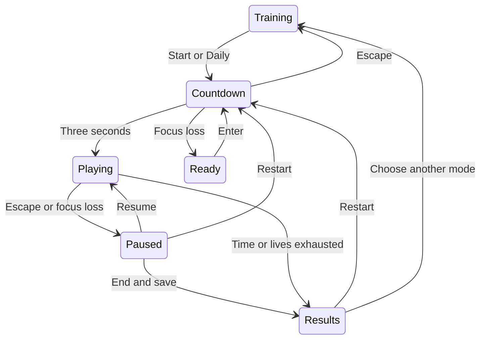

# Architecture and maintenance guide

The public launcher calls `aimtrainer.app.main()`. Importing the package or model does not create a window. `Game` owns the display, one event loop, active settings, profile Store, optional Audio and a Painter. A Session exists only while starting/playing/inspecting a run.

| Module | Responsibility | Important boundary |
|---|---|---|
| `model.py` | Session simulation, target bounds, scoring, daily seeds and achievement evidence | Pure Python; no device or file access |
| `app.py` | Input translation, screen transitions, pause/countdown, rendering coordination and result saving | Only Playing advances the Session |
| `ui.py` | Fixed-canvas rendering, button hit rectangles, cached text and crosshair drawing | UI button rectangles use logical coordinates |
| `audio.py` | Precomputed tones and optional playback | Failure is silent and nonfatal |
| `storage.py` | Validated profile/settings/history JSON and CSV | Saves are local, bounded and atomically replaced |

## State transitions

Statistics, Profiles, Settings and Help are workspace states. Escape returns from them to Training. Any state accepts a window-close event. Closing during an unfinished attempt discards that attempt. Restart discards the current unfinished attempt; ending through the pause menu saves it.

## Simulation

`Session.update(dt)` accumulates elapsed active time and advances in 1/120-second steps. Spawning uses the session RNG, independent of the visual-effects RNG. Target age and current collision radius are derived from active time. Tracking uses deterministic reflected motion within the arena. Combo timing uses the same clock. Paused/countdown states do not call Session.update.

One click can hit at most one target. Non-left buttons, off-canvas positions and HUD/outside-arena clicks are ignored. Targets are removed exactly once on hit or expiry. All competitive click modes lose lives on expiry/miss; Practice is exempt and Tracking has no shots/life penalty.

## Display and input

Painter draws on a 1440 × 900 logical surface. Game scales it into the actual display with preserved aspect ratio. The viewport stores offset and dimensions; event positions are transformed into logical coordinates. During shake, the same offset is used for input mapping. Black margins return no position. Window resize updates the viewport before following queued clicks are handled.

Targets and crosshair remain synchronized through this mapping. A lower render rate can still reduce what the human sees and when OS events arrive; fixed-step simulation does not eliminate real hardware/display latency. Tracking dwell uses the pointer sample available to the current update.

## Persistence

Schema 2 stores active profile and a profiles mapping. Each profile holds validated Settings and at most 1,000 recent session dictionaries. Rows store mode, difficulty, configured duration, result metrics, version, seed, challenge date, unique ID and a UTC timestamp.

Before saving, JSON is written to a temporary file in the same folder, flushed and fsynced, then replaced with `os.replace`. Parsing errors and unknown top-level schemas create a recovery copy. Invalid record types are skipped. Write failure shows a notice and keeps in-memory data for the current process. Concurrent application instances sharing one folder are unsupported; run one instance per data directory.

Local profiles are organizational and not authentication. Files are not encrypted or signed. No network request, telemetry, external command execution or other-game integration is included.

## Extending the project

Add game rules to the pure model first, then add mode-specific UI and regression tests. Keep board grouping aligned with every gameplay setting that affects comparability. Add new save fields with defaults and a schema migration if their meaning changes. Keep legacy files separate; the v2 launcher never imports `legacy/v1.0`.

The optional GitHub CI matrix exercises headless checks; real target-machine playtesting should also check physical mouse behavior, audio, fullscreen and high-DPI scaling.
